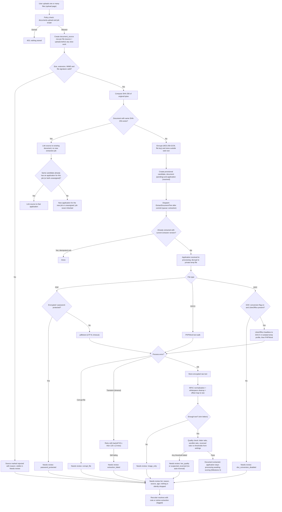

# Milestone 1 Plan — Foundation, jobs & criteria, documents

Status: approved for build after the Step 3 self-review below (15/10/2026).
Sources of truth: spec v0.2 (`specs/recruitment/spec/recruitment-tool-spec-EN-v0.2.md`), `research/stack-facts.md`,
`research/best-practices-2026-10-14.md` §4, `context/offer-scope-EN.txt`, and the build kickoff prompt (§5 overrides).

## 1. Objective

Deliver a running Laravel 13 + Filament v5 application that a reviewer can log into (MFA enforced), with:
the role/permission matrix enforced server-side, the full core data model, jobs and versioned criteria,
manual CV upload with encrypted storage, duplicate detection, PDF/DOCX extraction, Unicode normalization,
a text-quality gate and a visible "Needs review" list, an access log, and a settings screen.
Mail intake, AI, scoring, dashboards and retention jobs are **not** in this milestone.

## 2. Scope → requirement IDs

| Area | Requirement IDs (M1 part only) | Delivered as |
|---|---|---|
| Accounts, MFA, roles, matrix | `M9-P0-01`, `M9-P0-02`, `M9-P0-03`, `M9-P0-04`, `SEC-P0-01`, `SEC-P0-04` | Filament panel with required TOTP MFA + recovery codes, 30-min idle sessions (database driver), spatie roles, policies on every resource and on the download route, session invalidation on role revocation, `recruit:mfa-reset` command (logged) |
| Jobs & criteria | `M4-P0-01`, `M4-P0-02`, `M4-P0-03`, `SC-P0-02`, `SC-P0-04`, kickoff §5.3–5.4 | `RecruitmentJobResource`, `CriteriaVersion` relation manager + criteria editor; `CriteriaValidator` domain service; immutable approved versions |
| Documents (upload path) | `M2-P0-01` (upload only), `M2-P0-02`, `M2-P0-03`, `M2-P0-04`, `M3-P0-01` (hash part), `WF-P0-01` (accounting per item) | `UploadDocuments` action, `ExtractDocumentText` queued job, `TextQualityChecker`, `NeedsReview` resource |
| Text handling | `TXT-P0-01`, `TXT-P0-02`, `TXT-P0-03`, `TXT-P0-04`, `TXT-P0-06` (`T-TXT-01`) | `TextNormalizer`, `SearchNormalizer`, `PhoneNormalizer`, `ReversedTextDetector`, golden tests |
| Data model | `ARC-P0-02`, `ARC-P0-04`, §9.3 tables + kickoff §5.1/5.2/5.5/5.6 | migrations, models, factories, relations |
| Access log | `M10-P0-03` (view/download part) | activitylog events + `ActivityLogResource` |
| Settings | `M11-P0-03` (retention, quality, upload, language) | `ManageSettings` page + `Settings` repository with audit |
| Fixtures | `QA-P0-02` (12+ of the 40; rest in later milestones) | `tests/Fixtures/cvs/` + generator + `manifest.json` |

Out of scope now (tables only, no UI/logic): mailboxes, intake messages (raw `.eml` fields), extractions' `fields_json`,
scores, criterion results, overrides, notes UI, status-change UI, AI runs, privacy requests, deletion ledger, backup runs, notice outbox.

## 3. Upload → needs-review flow

## 4. Module / file list

All files are `[NEW]` (new repository `recruit-app/`), except skeleton files marked `[MODIFY]`.

**Config & bootstrap**
- `[MODIFY] composer.json` — packages, `scripts`: `lint`, `lint:fix`, `stan`, `test`, `gates`, `fixtures`
- `[MODIFY] .env.example` — every key (spec §9.5 list + Laravel), no secrets
- `[MODIFY] config/app.php`, `config/database.php` (utf8mb4_0900_ai_ci), `config/session.php`
- `[NEW] config/recruitment.php` — defaults for settings, field registry, protected terms, extraction binaries, limits
- `[NEW] app/Providers/Filament/AdminPanelProvider.php` — panel, MFA required, local font, Cairo timezone, user-menu language switch
- `[MODIFY] app/Providers/AppServiceProvider.php` — policies, Filament defaults (dd/mm/yyyy, Western digits), rate limits
- `[NEW] app/Http/Middleware/ApplyUserLocale.php`, `[NEW] app/Http/Controllers/LocaleController.php`, `[NEW] app/Http/Controllers/DocumentDownloadController.php`
- `[MODIFY] routes/web.php`, `[MODIFY] bootstrap/app.php`

**Domain (no Filament imports)**
- `app/Domain/Text/{TextNormalizer, NormalizedText, SearchNormalizer, PhoneNormalizer, PhoneNumberResult, ReversedTextDetector, TextQualityChecker, TextQualityReport, Wordlist}.php`
- `app/Domain/Criteria/{CriterionField, CriterionOperator, CriterionType, CriteriaValidator, CriteriaValidationResult, ProtectedAttributeGuard}.php`
- `app/Domain/Applications/{ApplicationStatus, StatusTransitionGuard}.php`
- `app/Domain/Documents/{FileSignature, DocumentKind, DocumentStatus, ReviewReason, SourceChannel, Disposition}.php`
- `app/Domain/Access/{Permission, Role, JobScope}.php`
- `app/Domain/Privacy/{RetentionTrack, NameBlindPolicy}.php`

**Services / actions / infrastructure**
- `app/Actions/Documents/UploadDocuments.php`, `app/Actions/Criteria/{StartDraftVersion, ApproveCriteriaVersion, SaveCriterion}.php`, `app/Actions/Users/{SyncUserAccess, SetUserActive, ResetUserMfa}.php`, `app/Actions/Review/ResolveReviewItem.php`
- `app/Services/Settings/SettingsRepository.php`, `app/Services/Applications/ApplicationStatusService.php`
- `app/Infrastructure/Storage/{ContentEncrypter, EncryptedDocumentStore}.php`, `app/Infrastructure/Extraction/{TextExtractor, PdfTextExtractor, DocxTextExtractor, DocConverter, ExtractionException}.php`
- `app/Casts/EncryptedContent.php`
- `app/Jobs/ExtractDocumentText.php`
- `app/Console/Commands/{ResetMfa, GenerateFixtures}.php`

**Models + factories + migrations** (§9.3 + kickoff §5): `User`, `RecruitmentJob`, `CriteriaVersion`, `Criterion`, `Candidate`, `Document`, `DocumentSource`, `Extraction`, `Application`, `Score`, `CriterionResult`, `Override`, `Note`, `StatusEvent`, `Mailbox`, `IntakeMessage`, `AiRun`, `PrivacyRequest`, `DeletionLedgerEntry`, `Setting`, `BackupRun`, `NoticeOutbox`; pivot `recruitment_job_user`.

**Policies**: `RecruitmentJobPolicy`, `CriteriaVersionPolicy`, `CriterionPolicy`, `CandidatePolicy`, `ApplicationPolicy`, `DocumentPolicy`, `DocumentSourcePolicy`, `UserPolicy`, `ActivityPolicy`, `SettingPolicy`.

**Filament (thin; calls actions)**: `RecruitmentJobResource` (+ `CriteriaVersionsRelationManager`), `CriteriaVersionResource` (criteria editor), `ApplicationResource` (read list, minimal), `NeedsReviewResource`, `UserResource`, `ActivityLogResource`, pages `UploadDocuments`, `ManageSettings`.

**Lang**: `lang/{ar,en}/{app,enums,validation,auth,passwords,pagination}.php`.
**Assets**: `public/fonts/noto-sans-arabic/*` (OFL, self-hosted) + `font.css`.
**Seeders**: `RolesAndPermissionsSeeder`, `SettingsSeeder`, `DemoUsersSeeder` (local/testing only), `DemoJobsSeeder` (illustrative, local only).
**Tests**: `tests/Unit/Text/*` (golden `T-TXT-01`), `tests/Unit/Criteria/*`, `tests/Feature/{Auth, Permissions, Criteria, Documents, Locale, Settings, AccessLog, Schema}/*`, `tests/Fixtures/cvs/*` + `manifest.json`.
**Docs**: `docs/PLAN.md`, `docs/DECISIONS.md`, `README.md`.

## 5. Step 3 — self-review against spec IDs and kickoff §5 (gaps found → fixed above)

| Check | Finding | Fix applied to plan |
|---|---|---|
| `WF-P0-01` "log before slow work" | First draft created the document before the source row | Source row is created first for every file, including rejected ones |
| "Nothing silently dropped" | Rejected (bad MIME/oversized) files had no document, so no list could show them | Review state lives on `document_sources`; the Needs-review list reads sources |
| `M3-P0-01` job not inherited | Duplicate upload to a different job initially reused the application | New application per (candidate, job); unassigned never inherits a job |
| Kickoff §5.1 channel-agnostic | Only `document_sources` had a source | `source` + `external_reference` on `applications`, `document_sources` and `intake_messages` |
| Kickoff §5.2 raw message | `.eml` storage missing | `intake_messages.raw_path`, `raw_sha256`, `raw_size` columns (used in M2) |
| Kickoff §5.3 location | Field registry had `governorate`/`city` | Removed; added `can_reach_plant_for_shift` (human-answered, never inferred) |
| Kickoff §5.4 protected | Whitelist alone gives a vague error | Explicit `ProtectedAttributeGuard` with named rejection + keyword scan of labels/targets; legal minimum-age check only with a documented legal basis |
| Kickoff §5.5 two tracks | Only one retention days setting | `applications.retention_track`, `handed_over_at`; settings for applicant days, idle days, hard max, owner notice, hired hand-over days |
| Kickoff §5.6 name-blind | Missing | `users.name_blind_review`, `recruitment_jobs.name_blind_review`, `NameBlindPolicy` |
| Kickoff §5.7 LLM rejection text | Not representable in M1 code | Recorded in `DECISIONS.md` as a design rule for M3/M4 |
| `M9-P0-01` coordinator | User management could let the coordinator grant itself CV access | Coordinator can provision/deactivate accounts but cannot assign roles or permissions |
| `M9-P0-03` | Revocation did not end sessions | `SyncUserAccess` logs old/new roles and deletes the user's database sessions when access is reduced |
| `TXT-P0-03` attribution map | NFKC changes string length | Offset map built per base-character segment, stored encrypted |
| `TXT-P0-04` Western digits | Filament `numeric()`/dates may use the Arabic locale's digits | Dates as `d/m/Y` numeric formats; numbers formatted with a Latin-digit locale; test asserts no U+0660–0669 on rendered pages |
| Idempotency | Duplicate dispatch could double-extract | Job is unique per document, uses `WithoutOverlapping`, and exits when a current extraction exists |
| MySQL portability | `collation()` on SQLite emits invalid SQL | Binary collations applied only when the driver is MySQL |
| Hard-coded strings | Easy to slip Arabic into PHP | Test scans `app/`, `resources/views/`, `routes/` for Arabic letters |

Remaining open items are listed in `DECISIONS.md` (open questions) and in the final report.
