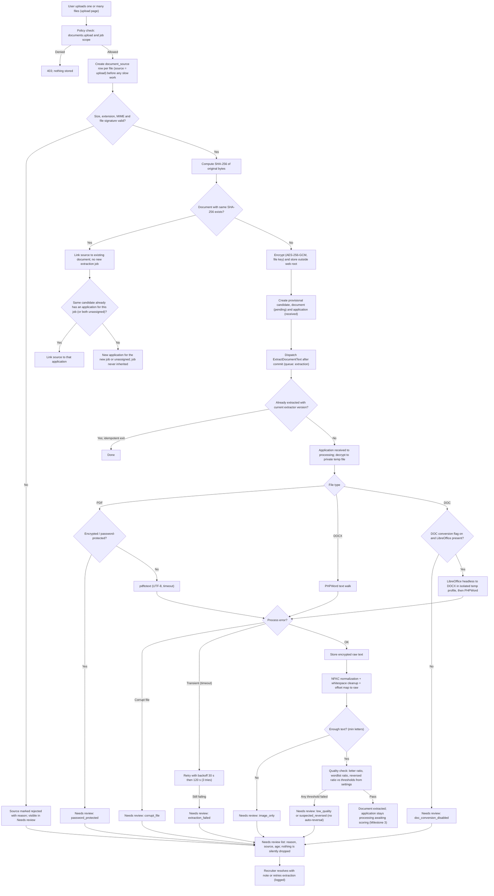
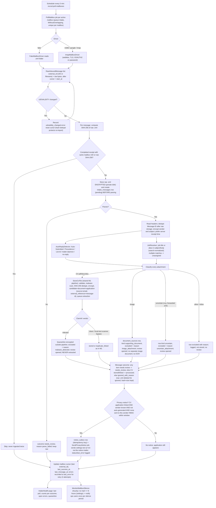
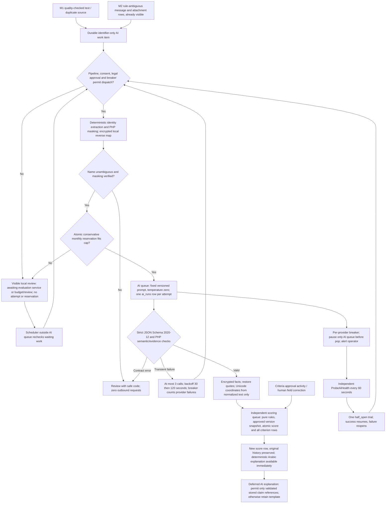
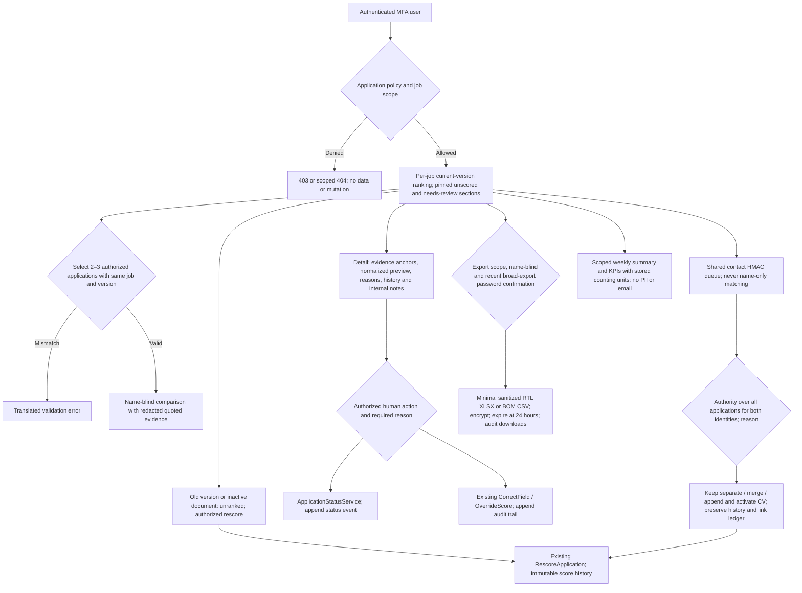

# Milestone 1 Plan — Foundation, jobs & criteria, documents

Status: approved for build after the Step 3 self-review below (15/10/2026).
Sources of truth: spec v0.2 (`specs/recruitment/spec/recruitment-tool-spec-EN-v0.2.md`), `research/stack-facts.md`,
`research/best-practices-2026-10-14.md` §4, `context/offer-scope-EN.txt`, and the build kickoff prompt (§5 overrides).

## 1. Objective

Deliver a running Laravel 13 + Filament v5 application that a reviewer can log into (MFA enforced), with:
the role/permission matrix enforced server-side, the full core data model, jobs and versioned criteria,
manual CV upload with encrypted storage, duplicate detection, PDF/DOCX extraction, Unicode normalization,
a text-quality gate and a visible "Needs review" list, an access log, and a settings screen.
Mail intake, AI, scoring, dashboards and retention jobs are **not** in this milestone.

## 2. Scope → requirement IDs

| Area | Requirement IDs (M1 part only) | Delivered as |
|---|---|---|
| Accounts, MFA, roles, matrix | `M9-P0-01`, `M9-P0-02`, `M9-P0-03`, `M9-P0-04`, `SEC-P0-01`, `SEC-P0-04` | Filament panel with required TOTP MFA + recovery codes, 30-min idle sessions (database driver), spatie roles, policies on every resource and on the download route, session invalidation on role revocation, `recruit:mfa-reset` command (logged) |
| Jobs & criteria | `M4-P0-01`, `M4-P0-02`, `M4-P0-03`, `SC-P0-02`, `SC-P0-04`, kickoff §5.3–5.4 | `RecruitmentJobResource`, `CriteriaVersion` relation manager + criteria editor; `CriteriaValidator` domain service; immutable approved versions |
| Documents (upload path) | `M2-P0-01` (upload only), `M2-P0-02`, `M2-P0-03`, `M2-P0-04`, `M3-P0-01` (hash part), `WF-P0-01` (accounting per item) | `UploadDocuments` action, `ExtractDocumentText` queued job, `TextQualityChecker`, `NeedsReview` resource |
| Text handling | `TXT-P0-01`, `TXT-P0-02`, `TXT-P0-03`, `TXT-P0-04`, `TXT-P0-06` (`T-TXT-01`) | `TextNormalizer`, `SearchNormalizer`, `PhoneNormalizer`, `ReversedTextDetector`, golden tests |
| Data model | `ARC-P0-02`, `ARC-P0-04`, §9.3 tables + kickoff §5.1/5.2/5.5/5.6 | migrations, models, factories, relations |
| Access log | `M10-P0-03` (view/download part) | activitylog events + `ActivityLogResource` |
| Settings | `M11-P0-03` (retention, quality, upload, language) | `ManageSettings` page + `Settings` repository with audit |
| Fixtures | `QA-P0-02` (12+ of the 40; rest in later milestones) | `tests/Fixtures/cvs/` + generator + `manifest.json` |

Out of scope now (tables only, no UI/logic): mailboxes, intake messages (raw `.eml` fields), extractions' `fields_json`,
scores, criterion results, overrides, notes UI, status-change UI, AI runs, privacy requests, deletion ledger, backup runs, notice outbox.

## 3. Upload → needs-review flow

## 4. Module / file list

All files are `[NEW]` (new repository `recruit-app/`), except skeleton files marked `[MODIFY]`.

**Config & bootstrap**
- `[MODIFY] composer.json` — packages, `scripts`: `lint`, `lint:fix`, `stan`, `test`, `gates`, `fixtures`
- `[MODIFY] .env.example` — every key (spec §9.5 list + Laravel), no secrets
- `[MODIFY] config/app.php`, `config/database.php` (utf8mb4_0900_ai_ci), `config/session.php`
- `[NEW] config/recruitment.php` — defaults for settings, field registry, protected terms, extraction binaries, limits
- `[NEW] app/Providers/Filament/AdminPanelProvider.php` — panel, MFA required, local font, Cairo timezone, user-menu language switch
- `[MODIFY] app/Providers/AppServiceProvider.php` — policies, Filament defaults (dd/mm/yyyy, Western digits), rate limits
- `[NEW] app/Http/Middleware/ApplyUserLocale.php`, `[NEW] app/Http/Controllers/LocaleController.php`, `[NEW] app/Http/Controllers/DocumentDownloadController.php`
- `[MODIFY] routes/web.php`, `[MODIFY] bootstrap/app.php`

**Domain (no Filament imports)**
- `app/Domain/Text/{TextNormalizer, NormalizedText, SearchNormalizer, PhoneNormalizer, PhoneNumberResult, ReversedTextDetector, TextQualityChecker, TextQualityReport, Wordlist}.php`
- `app/Domain/Criteria/{CriterionField, CriterionOperator, CriterionType, CriteriaValidator, CriteriaValidationResult, ProtectedAttributeGuard}.php`
- `app/Domain/Applications/{ApplicationStatus, StatusTransitionGuard}.php`
- `app/Domain/Documents/{FileSignature, DocumentKind, DocumentStatus, ReviewReason, SourceChannel, Disposition}.php`
- `app/Domain/Access/{Permission, Role, JobScope}.php`
- `app/Domain/Privacy/{RetentionTrack, NameBlindPolicy}.php`

**Services / actions / infrastructure**
- `app/Actions/Documents/UploadDocuments.php`, `app/Actions/Criteria/{StartDraftVersion, ApproveCriteriaVersion, SaveCriterion}.php`, `app/Actions/Users/{SyncUserAccess, SetUserActive, ResetUserMfa}.php`, `app/Actions/Review/ResolveReviewItem.php`
- `app/Services/Settings/SettingsRepository.php`, `app/Services/Applications/ApplicationStatusService.php`
- `app/Infrastructure/Storage/{ContentEncrypter, EncryptedDocumentStore}.php`, `app/Infrastructure/Extraction/{TextExtractor, PdfTextExtractor, DocxTextExtractor, DocConverter, ExtractionException}.php`
- `app/Casts/EncryptedContent.php`
- `app/Jobs/ExtractDocumentText.php`
- `app/Console/Commands/{ResetMfa, GenerateFixtures}.php`

**Models + factories + migrations** (§9.3 + kickoff §5): `User`, `RecruitmentJob`, `CriteriaVersion`, `Criterion`, `Candidate`, `Document`, `DocumentSource`, `Extraction`, `Application`, `Score`, `CriterionResult`, `Override`, `Note`, `StatusEvent`, `Mailbox`, `IntakeMessage`, `AiRun`, `PrivacyRequest`, `DeletionLedgerEntry`, `Setting`, `BackupRun`, `NoticeOutbox`; pivot `recruitment_job_user`.

**Policies**: `RecruitmentJobPolicy`, `CriteriaVersionPolicy`, `CriterionPolicy`, `CandidatePolicy`, `ApplicationPolicy`, `DocumentPolicy`, `DocumentSourcePolicy`, `UserPolicy`, `ActivityPolicy`, `SettingPolicy`.

**Filament (thin; calls actions)**: `RecruitmentJobResource` (+ `CriteriaVersionsRelationManager`), `CriteriaVersionResource` (criteria editor), `ApplicationResource` (read list, minimal), `NeedsReviewResource`, `UserResource`, `ActivityLogResource`, pages `UploadDocuments`, `ManageSettings`.

**Lang**: `lang/{ar,en}/{app,enums,validation,auth,passwords,pagination}.php`.
**Assets**: `public/fonts/noto-sans-arabic/*` (OFL, self-hosted) + `font.css`.
**Seeders**: `RolesAndPermissionsSeeder`, `SettingsSeeder`, `DemoUsersSeeder` (local/testing only), `DemoJobsSeeder` (illustrative, local only).
**Tests**: `tests/Unit/Text/*` (golden `T-TXT-01`), `tests/Unit/Criteria/*`, `tests/Feature/{Auth, Permissions, Criteria, Documents, Locale, Settings, AccessLog, Schema}/*`, `tests/Fixtures/cvs/*` + `manifest.json`.
**Docs**: `docs/PLAN.md`, `docs/DECISIONS.md`, `README.md`.

## 5. Step 3 — self-review against spec IDs and kickoff §5 (gaps found → fixed above)

| Check | Finding | Fix applied to plan |
|---|---|---|
| `WF-P0-01` "log before slow work" | First draft created the document before the source row | Source row is created first for every file, including rejected ones |
| "Nothing silently dropped" | Rejected (bad MIME/oversized) files had no document, so no list could show them | Review state lives on `document_sources`; the Needs-review list reads sources |
| `M3-P0-01` job not inherited | Duplicate upload to a different job initially reused the application | New application per (candidate, job); unassigned never inherits a job |
| Kickoff §5.1 channel-agnostic | Only `document_sources` had a source | `source` + `external_reference` on `applications`, `document_sources` and `intake_messages` |
| Kickoff §5.2 raw message | `.eml` storage missing | `intake_messages.raw_path`, `raw_sha256`, `raw_size` columns (used in M2) |
| Kickoff §5.3 location | Field registry had `governorate`/`city` | Removed; added `can_reach_plant_for_shift` (human-answered, never inferred) |
| Kickoff §5.4 protected | Whitelist alone gives a vague error | Explicit `ProtectedAttributeGuard` with named rejection + keyword scan of labels/targets; legal minimum-age check only with a documented legal basis |
| Kickoff §5.5 two tracks | Only one retention days setting | `applications.retention_track`, `handed_over_at`; settings for applicant days, idle days, hard max, owner notice, hired hand-over days |
| Kickoff §5.6 name-blind | Missing | `users.name_blind_review`, `recruitment_jobs.name_blind_review`, `NameBlindPolicy` |
| Kickoff §5.7 LLM rejection text | Not representable in M1 code | Recorded in `DECISIONS.md` as a design rule for M3/M4 |
| `M9-P0-01` coordinator | User management could let the coordinator grant itself CV access | Coordinator can provision/deactivate accounts but cannot assign roles or permissions |
| `M9-P0-03` | Revocation did not end sessions | `SyncUserAccess` logs old/new roles and deletes the user's database sessions when access is reduced |
| `TXT-P0-03` attribution map | NFKC changes string length | Offset map built per base-character segment, stored encrypted |
| `TXT-P0-04` Western digits | Filament `numeric()`/dates may use the Arabic locale's digits | Dates as `d/m/Y` numeric formats; numbers formatted with a Latin-digit locale; test asserts no U+0660–0669 on rendered pages |
| Idempotency | Duplicate dispatch could double-extract | Job is unique per document, uses `WithoutOverlapping`, and exits when a current extraction exists |
| MySQL portability | `collation()` on SQLite emits invalid SQL | Binary collations applied only when the driver is MySQL |
| Hard-coded strings | Easy to slip Arabic into PHP | Test scans `app/`, `resources/views/`, `routes/` for Arabic letters |

Remaining open items are listed in `DECISIONS.md` (open questions) and in the final report.

---

# Milestone 2 Plan — Mail intake

Status: approved for build after the Step 3 self-review below (16/10/2026).
Sources of truth: spec v0.2 §5.3, §6.1 (`M1-P0-01…05`), §6.2 (`M2-P0-02` malware part), §6.3 (`M3-P0-01` dedupe part), §6.10 (`M10-P0-01`), §6.11 (`M11-P0-01`), §9.3–§9.5; kickoff §3 (webklex/php-imap, no ext-imap), §5.1–§5.2; M2 build brief.

## M2.1 Objective

Poll recruitment mailboxes (IMAP password/OAuth2 via `webklex/php-imap`, or a folder of `.eml` files
for tests/local), store every raw message **encrypted with its SHA-256 before any parsing**, classify
attachments (CV / image / other, every outcome with a reason), malware-scan CVs (ClamAV clamd socket,
fake in tests), feed CVs into the M1 upload/extraction pipeline with `source = email`, de-duplicate at
message and file level, queue the privacy auto-reply through `notice_outbox` (max one per sender per
window, never to auto-generated mail), show intake health, and alert when no mail arrives for N hours.

## M2.2 Scope → requirement IDs

| Area | Requirement IDs | Delivered as |
|---|---|---|
| Driver contract | `M1-P0-04` (3 setups, kickoff §3) | `MailboxDriver` interface; `ImapMailboxDriver` (password TLS + XOAUTH2 for M365/Google via token endpoint), `FakeMailboxDriver` (`.eml` folder) |
| Poll & cursor | `M1-P0-01`, §9.4 `PollMailbox` | `PollMailbox` queued job per mailbox (queue `intake`, overlap lock, unique), `recruit:poll-mailboxes` command, scheduler entry, cursor + `uidvalidity` + `start_at` |
| Raw-first & idempotency | kickoff §5.2, §9.4 `PersistIntake`, `T-M1-01` | `ProcessInboundMessage` action; unique `(mailbox_id, external_id)`, skip by `raw_sha256` or `Message-ID`; raw `.eml` encrypted at rest |
| Classification | `M1-P0-02`, `M1-P0-03`, `M1-P0-05`, `M2-P0-01` (mail part) | `AttachmentClassifier`, `JobResolver` (title/alias in subject+body, ambiguity → unassigned), per-attachment `document_sources` rows with reasons, nothing silently dropped |
| Malware | `M2-P0-02` (malware part) | `MalwareScanner` interface; ClamAV clamd driver; `NullScanner` behind a flag; quarantine (encrypted, outside pipeline), infected never extracted |
| De-duplication | `M3-P0-01` (file part), `T-M1-01` | SHA-256 reuse of the M1 `StoreCvFile` path + message-level hash/`Message-ID` skip |
| Privacy auto-reply | `M10-P0-01`, §5.3 notice sender | `notice_outbox` row + `SendPrivacyNotice` job; text from settings (ar/en, seeded from lang); one per sender per window; `AutoReplyDetector` suppression |
| Intake health | `M11-P0-01`, §9.4 `HealthCheck` | `IntakeHealth` Filament page (last poll, counts per outcome, errors, quarantine); `MonitorMailboxSilence` scheduled alert (N hours in settings) |
| Fixtures & tests | `T-M1-01…04`, `T-M2-02/04`, brief §9 | 12 synthetic `.eml` fixtures + runtime EICAR; Pest tests through the fake driver |

Out of scope: AI classification of ambiguous mail (M3), retention deletion (M4), WhatsApp/web-form
channels (schema only), candidate messaging.

## M2.3 Intake flow

## M2.4 Module / file list

**Config & env** — `[MODIFY] config/recruitment.php` (intake, malware, quarantine/intake prefixes, queue names, dedup HMAC key), `[MODIFY] config/mail.php` (notice mailer fallback), `[MODIFY] .env.example`, `[MODIFY] phpunit.xml` (DEDUP_HMAC_KEY test value), `[MODIFY] routes/console.php` (scheduler), `[MODIFY] app/Providers/AppServiceProvider.php` (MalwareScanner binding).

**Domain (`app/Domain/Intake/`)** — `[NEW] RawInboundMessage`, `InboundAttachment`, `ParsedInboundMessage`, `IntakeOutcome`, `IntakeReason`, `AttachmentClass`, `AttachmentClassifier`, `AutoReplyDetector`, `JobResolver`, `Contracts/MailboxDriver`, `Contracts/MessageParser`. `[MODIFY] app/Domain/Documents/{ReviewReason, DocumentKind}` (new cases).

**Infrastructure (`app/Infrastructure/Intake/`)** — `[NEW] WebklexMessageParser` (parses raw `.eml` via `Message::fromString` — one parser for every driver), `ImapMailboxDriver` (password TLS / XOAUTH2; protocol EXAMINE + BODY.PEEK, never modifies the source), `OAuthAccessTokenProvider` (M365 client-credentials, Google refresh-token), `FakeMailboxDriver` (`.eml` folder; `mailbox.host` holds the folder). `[MODIFY] app/Infrastructure/Storage/EncryptedDocumentStore` (intake + quarantine prefixes).

**Malware (`app/Services/Malware/`)** — `[NEW] MalwareScanner` interface, `ScanVerdict`, `ClamAvScanner` (clamd INSTREAM socket), `NullMalwareScanner`.

**Actions / services** — `[NEW] app/Actions/Documents/StoreCvFile` (per-file pipeline extracted from `UploadDocuments`; used by upload **and** mail; adds malware scan + quarantine), `StoreOutcome`; `[NEW] app/Services/Intake/{MailboxDriverFactory, ProcessInboundMessage, PrivacyNoticeGate, IntakeHealthSnapshot}`; `[MODIFY] app/Actions/Documents/UploadDocuments` (gate/limits/logging stay; per-file work delegated to `StoreCvFile`).

**Jobs / scheduler / commands** — `[NEW] app/Jobs/{PollMailbox, SendPrivacyNotice, MonitorMailboxSilence}`, `app/Console/Commands/PollMailboxes`; `[MODIFY] app/Console/Commands/GenerateContentKey` (also writes `DEDUP_HMAC_KEY` when missing).

**Models & migrations** — `[MODIFY] Mailbox`, `IntakeMessage`, `DocumentSource` (new columns); `[NEW] migration` adding `intake_messages.sender_enc`, `document_sources.reason`, `mailboxes.last_silence_alert_at`, `mailboxes.silence_alert_hours` → nullable.

**Filament** — `[NEW] app/Filament/Pages/IntakeHealth.php` + view (thin; reads `IntakeHealthSnapshot`), gated by `ops.health.view`.

**Lang** — `[MODIFY] lang/{ar,en}/{app,enums}.php` (intake, settings, notice subject/body defaults, new enum cases).

**Seeders** — `[NEW] DemoMailboxSeeder` (local/testing: one `fake`-provider mailbox).

**Fixtures & tests** — `[NEW] tests/Fixtures/eml/` (12 `.eml` + generator script), `tests/Feature/Intake/*` (fake-driver pipeline, raw-first, idempotency, classification, malware/EICAR at runtime, dedupe, privacy notice, poll job, health page, silence alert, job resolver), `tests/Unit/Intake/*` (classifier, autoreply detector), `[MODIFY]` existing upload tests only where the shared action changed behaviour (none expected).

## M2.5 Step 3 — self-review against spec IDs and the brief

| Check | Finding | Fix applied to plan |
|---|---|---|
| `M1-P0-01` unique numbering | First draft keyed only by UID | Unique `(mailbox_id, external_id)` + `uidvalidity` tracked; change resets cursor and relies on hash/`Message-ID` dedupe (`T-M1-03` catch-up) |
| Kickoff §5.2 raw-first | Draft parsed to get `Message-ID` before storing raw | Raw stored + hashed before any parsing; dedupe by hash first, `Message-ID` checked after parse |
| `M1-P0-03` "every attachment visible" | Inline signature images would flood Needs review | Inline (cid-referenced) images get logged rows with reason `inline_image` but no review item; decision D-105 |
| `M1-P0-05` ID photos default non-retention | Storing images would retain sensitive photos by default | Images never stored in M2; metadata row + reason + review only (D-106) |
| `M2-P0-02` malware also applies to upload | Draft scanned only mail attachments | Scan lives in shared `StoreCvFile`, so both channels scan (D-107) |
| Spec §9.3 "ignored records: minimal record without the body" | Raw `.eml` of ignored mail keeps the body forever | Ignored messages drop the stored raw (hash + size + metadata kept); processed/needs-review keep it (D-108) |
| `M10-P0-01` "once per registered submission" vs brief "one per sender per window" | Two rules, one must win operationally | Idempotency key per message; window check suppresses re-sending to the same sender HMAC within the configurable window (D-109) |
| §5.3 notice sender has separate credentials | Notice would reuse the app mailer | Dedicated notice mailer from `MAIL_SEND_TRANSPORT` (D-110) |
| Duplicate infected file re-sent | Could open a new review row each time | Re-scan on every receipt; quarantine path keyed by SHA-256 so no new file; one review row per source (per message) — accepted noise (D-111) |
| `start_at` semantics | "Defining an operational start date prevents automatic archive import" | Driver filters `received_at >= start_at` after cursor; fake driver too (D-112) |
| Job never inherited (`M3-P0-01`) | Duplicate CV arriving by mail for another job | Reuses `StoreCvFile` which already creates a new application per (candidate, job) |
| Windows dev has no clamd / ext constraints | Quahog needs ext-sockets? | ClamAV driver behind `MALWARE_SCANNER` flag (`null` default locally); clamd client chosen after install check (D-113) |
| Arabic literals rule | Default notice text would put Arabic in config | Default text lives in `lang/ar|en`; seeder copies it into settings; sender falls back to lang (D-114) |

## M2.6 Completion review — 17/10/2026

| Brief item | Verification |
|---|---|
| 1. Driver contract, fake + IMAP/TLS/OAuth2 | `FakeDriverTest`, `ImapDriverTest`: offline folder, original raw protocol bytes, TLS verification, M365/Google HTTP fakes; no live mailbox. |
| 2. Raw-first, hash/size, retry and start pointer | `IntakePipelineTest`, `IntakeRecoveryTest`: instrumented MIME boundary, failed raw write, pending receipt recovery, default start date; `ImapDriverTest` covers UIDVALIDITY reset and UID reuse. |
| 3. Attachment classification and M1 pipeline | `IntakePipelineTest`: Arabic/English, multiple CVs, images, unknown/forwarded/inline/extensionless attachments, job title/alias and conflict; every item has a disposition/reason. |
| 4. Malware | `MalwareQuarantineTest`, `ClamdClientTest`, recovery tests: runtime-only EICAR, encrypted quarantine, no candidate/document/extraction for infected bytes, fail-closed scanner outage. |
| 5. Dedupe | `IntakeDeduplicationTest`, recovery tests: raw hash, Message-ID, file SHA-256, replay and partial batch resume; M1 upload tests remain unchanged. |
| 6. Notice | `PrivacyNoticeTest`, recovery tests: configurable Arabic/English copy, window across mailboxes, automated/bulk suppression, durable outbox, duplicate jobs and uncertain transport outcome. |
| 7. Health and silence | `IntakeHealthTest`: all six roles allow/deny, visible counts/errors, configurable threshold and one alert per silence period. |
| 8. Scheduling | `PollMailboxJobTest`: queued job per active mailbox, overlap/unique middleware, exact five-minute/hourly schedule entries, cursor and safe error recording. |
| 9. Fixtures/tests/localization | 13 synthetic `.eml` files plus runtime exception cases; full M1 regression suite, translation parity/hints and Arabic-literal checks. |

Review priorities: resumable raw writes and scan failures, UIDVALIDITY namespace, uncertain notice delivery,
then production-only integration checks. No mailbox, SMTP, OAuth, clamd or database network service was contacted.
Only `webklex/php-imap` was added by the original M2 implementation; no further packages were installed.
M3 AI/scoring remains out of scope.

## M2.7 Measured gates — 17/10/2026

PHP 8.4.26, local Windows, no live services. Final full run executed alone after all code changes.

- `vendor/bin/pint --test`: passed, zero style failures.
- `vendor/bin/phpstan analyse --memory-limit=1G --no-progress`: passed, zero errors (level 6, no ignores/baseline).
- `php artisan test`: 341 tests, 340 passed, 1 existing LibreOffice skip, 1089 assertions; zero failures/errors (150.611 s).
- `php artisan migrate:fresh --seed`: passed on a new isolated SQLite database; 11 migrations and 4 seeders completed.
- All 239 M1 cases remain: 238 pass and the original LibreOffice-dependent case skips; no M1 tests weakened.
- 13 synthetic `.eml` fixtures; EICAR assembled only at runtime. Changed-file inventory is `CHANGED-FILES.txt`.

Evidence: `storage/logs/m2-final-isolated.xml` (ignored local JUnit artifact).
`.env` SHA-256 was unchanged during repair. No commit, push, deployment, package installation, or real-service connection.
MySQL, live provider privileges/TLS, clamd and approved sending/retention remain deployment acceptance checks.

---

# Milestone 3 Plan — AI engine and scoring

Status: complete after Steps 1–7; offline gates passed on 17/10/2026. See `docs/M3-VERIFICATION.md` for evidence and acceptance limits.
Sources: v0.2 §6.5–6.6, §7–8, §9.3–9.5, §12–13, Appendix B S04/M5; kickoff §3–6/8; M3 brief overrides.

## M3.1 Objective and scope

Verified document facts feed a pure deterministic evaluator; AI never returns a score or candidate messages.
All outbound text is masked in PHP. Cloud remains disabled until explicit configuration, verified consent,
masking and a permission-protected legal reference agree. Intake and scoring remain independent of AI outages.
No M4 review/export/retention/calibration UI, no live calls, no changes to .env, no commit/push/deploy.

## M3.2 Flow (Steps 1–2)

## M3.3 File/module list (Step 4)

- [NEW] `app/Domain/Ai/`: exact provider contract, typed masked inputs/results/errors, masker, identity rules,
  versioned schema validator and verbatim quote verifier. `resources/ai/`: JSON schema and prompt files.
- [NEW] `app/Domain/Scoring/`: outcomes, synonym dictionary, fact projection, operators, bands, template/claim validation.
- [NEW] `app/Services/Ai/`: SDK/fake drivers, guarded metered gateway, atomic budget and breaker, durable work coordinator,
  consent records, extraction/classification/explanation services, safe ops snapshot and queue guard.
- [NEW] `app/Actions/Scoring/`: atomic scoring, correction and override actions; ranking query helper.
- [NEW] `app/Jobs/`: ExtractStructuredFields, ScoreApplication, ExplainScore, RescoreApplication, ClassifyAmbiguousIntake,
  ProbeAiHealth; scheduler dispatch/recovery command. [NEW] `app/Providers/AiServiceProvider.php` + model/activity observers.
- [NEW] companion control tables (consent, work, provider states, extraction context, corrections, evaluation keys).
  Existing tables/enums unchanged; existing fields hold facts/results/provenance as designed.
- [MODIFY] `ProcessInboundMessage` only to enqueue ambiguous classification after durable M2 accounting.
  Observe M1 extraction/source/application events for pipeline integration; do not rewrite M2 storage/scan/notice logic.
- [MODIFY] Composer (only laravel/ai, opis/json-schema), config, .env.example, settings permission boundary, seeder,
  routes/console, bootstrap/providers, lang/ar/en; [NEW] thin AI operations/settings page and views.
- [NEW] synthetic recorded responses, masking corpus, golden/unit/integration tests; docs/README updated with worker commands.

## M3.4 Step 3 self-review and corrections

| Requirement | Gap found | Plan correction |
|---|---|---|
| ARC-P0-03 / M5-P0-06 | Middleware release would consume attempts during breaker waits | Pause only AI queue before pop; durable waiting records and independent scheduler; actual-call count bounded independently |
| M6-P0-01 | Scoring on a paused queue would stop rules | ScoreApplication/RescoreApplication use independent scoring queue |
| PRIV-P0-05 / M9-P0-03 | No consent storage or dedicated AI permission exists | Companion consent ledger, server-side settings guard; dedicated permission string, no role-by-default cloud enablement |
| SC-P0-01 / kickoff 5.3 | Location keys required by spec but forbidden by brief | Keep required keys fixed to null; document deviation D-124 |
| SC-P0-05 / ARC-P0-02 | Overwriting extraction on correction loses evidence | Append encrypted correction rows, apply by application during new atomic evaluation |
| M6-P0-03 | Free Arabic prose cannot be reliably fact-checked | Model selects stored Arabic claim IDs/order with verbatim evidence; local renderer rejects unknown/altered claims, template immediate |
| SC-P0-01 | Repeated quotes cannot be guessed | Resolve with page boundaries only; otherwise confidence zero and review |
| M5-P0-05 | Crash/timeout may incur unknown cost | Retain full reservation for uncertain failures; reconciliation never exceeds it; cap uses actual plus outstanding reserves |
| M3-P0-01 | Duplicate/new job needs score without modifying M2 | Observe linked application/source records; reuse valid extraction, idempotency by application/version/extraction/correction revision |
| D-90 / AC03 | Scores could accidentally imply status decisions | Rules return bands/review flags only; application workflow handled separately without human decision transitions |

## M3.5 QA / delivery (Steps 6–7)

Offline tests: strict contracts/injection, Arabic Unicode and repeated quotes, deterministic identity/masking,
zero outbound blocked-cloud requests, bounded retries/cap/half-open, 30 outage arrivals, worked example C1–C8
(S65/C80; corrected S85 with history), gates/denominator/synonyms/ranking/fairness, activity-driven rescoring,
correction/override permissions, deleted-record races, operations page excludes CV text.
Run PHP 8.4 composer lint, composer stan (level 6/no baseline), composer test, and migrate:fresh --seed
against a NEW isolated SQLite file with process-only safe synthetic settings (D-123). Report exact counts.
Local model endpoint acceptance and calibration stay open for staging in Egypt; cloud stays disabled.

## M3.6 Step 6 self-review findings resolved during build

- Disabled SDK-internal Retry-After retries so three jobs cannot issue six unmetered requests; mocked
  wire tests assert exactly three calls and matching persisted X-Request-ID values.
- Durable attempt increment and reservation share a transaction before dispatch; worker death cannot
  reset retry accounting. Lost score dispatches are recovered independently from the paused AI queue.
- Score/result/correction/override updates are blocked after initial persistence. Validated explanation
  enrichment uses a separate encrypted row; original deterministic reasons remain unchanged.
- Each membership criterion keeps its own matched evidence, rather than another skill's quotation.
  C1 checks specialization on the same degree; shift availability needs a shift-specific statement.
- Name sources are checked for conflicting tokens, and sender names are read locally from the encrypted
  source only. Explanation snippets are masked before serialization. No attachments or metadata reach AI.
- Quote failures and unsupported numeric values keep confidence zero and a visible review code. Total
  experience can use a union of complete dates; missing dates and job-specific years are never guessed.
- Health failures can open the breaker even while idle; health waits for budget/approval do not count as
  provider failures. Both worker connections guard ai before pop; other queues remain consumable.
- All tests force fake/off defaults and block stray HTTP. Allowed local/cloud adapter tests use synthetic
  HTTP responses only. The existing M1/M2 tests remain unchanged.

Final gate evidence and remaining acceptance limits are recorded in `docs/M3-VERIFICATION.md`.

---

# Milestone 4a — Review and decisions

Status: complete after Steps 1–7 on 17/10/2026; offline gates passed. See docs/M4A-VERIFICATION.md.
Branch: `m4a-review-decisions`, based on `76f9a4d`. Scope: brief items 1–9 only.
Sources: kickoff sections 3–8; spec v0.2 sections 5.2/5.4, M6–M9, 7.4, 8,
9.3–9.5, 11–13, 15–17 and Appendix B; M3 verification; M4a brief overrides.
M4b remains separate: no retention/deletion/privacy/backup/health/calibration/go-live implementation.

## M4a.1 Plan and flow (Steps 1–2)

Deliver the complete synthetic weekly decision routine: scoped current-version ranking,
persistent exceptions, evidence/profile/history, same-job/version comparison, reasoned duplicate
resolution, authorized human statuses/notes/corrections/overrides, encrypted audited XLSX/CSV,
and an in-tool PII-free weekly summary/KPIs with voluntary pilot minutes.

## M4a.2 Self-review and revised file plan (Steps 3–4)

| Risk found | Revised implementation |
|---|---|
| Band/date/status filters can conceal unscored items | Separate paginated pinned exceptions query ignores list filters; counts always visible |
| Old score can reference the current version but a replaced CV | Ranking additionally checks active document; historical score remains unranked |
| Evidence can leak identity under name-blind | Redact identity tokens from comparison evidence; never render raw normalized text there |
| A duplicate merge can affect hidden applications | Require review.manage and visibility of every linked application for both candidates, rechecked under locks |
| Merge can destroy same-job score history | Reparent applications without collapsing/deleting them; preserve opaque alias and append link snapshots |
| UI-only restrictions permit forged status actions | Policy checks in the sole status service, lock before transition; owner-only reopen |
| Export can bypass scope after revocation or changed blind flags | Recheck creator, permissions, every included application and blind flags at download |
| Export plaintext or long-lived download URL | Dedicated private encrypted disk, authenticated route, 24-hour expiry and per-minute expiry cleanup |
| Weekly counts mix message/file/person/application units | Stored metric definitions and separate counts; distinct application counts for score/review/decision events |

- [MODIFY] Application resource/list and existing ranking helper; [NEW] detail and compare pages/views.
- [NEW] `Services/Review`, `Actions/Review`, review policy helpers, duplicate link ledger/model.
- [MODIFY] status service and correction/override authorization, model relations; preserve M1–M3 behavior.
- [NEW] export service/artifact model, controller, cleanup command, private disk and routes.
- [NEW] weekly report/KPI service, page, manual pilot log and metric-unit definitions.
- [NEW] additive M4a Schema API migration (duplicate resolutions, export artifacts, pilot logs, metric definitions,
  candidate merge-alias link); no M4b tables/jobs/pages.
- [NEW] paired `lang/ar/review.php`, `lang/en/review.php`, synthetic feature tests and verification report.
- [MODIFY] Composer with only the explicitly approved PhpSpreadsheet dependency and its transitive requirements.

## M4a.3 Verification and walkthrough (Steps 6–7)

Test server-side and rendered authorization, blind HTML, filters and deterministic ranking, historical rescore,
Unicode/XSS-safe highlights, duplicate actions/history, status/notes/correction/override, export reopen/sanitization,
scope revocation/expiry/audits, weekly reconciliation and explicit units. Then PHP 8.4 lint, stan, complete tests
and migrate:fresh --seed on a NEW isolated synthetic SQLite database. No .env changes or live services.
Exact results and walkthrough are recorded in `docs/M4A-VERIFICATION.md`: 499 passed, 1 existing skip, 2149 assertions; all four gates green.
